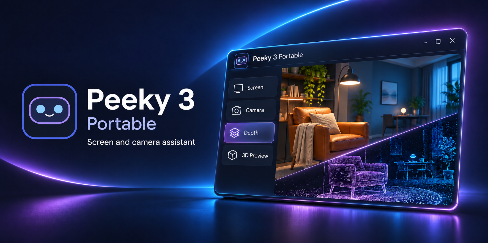
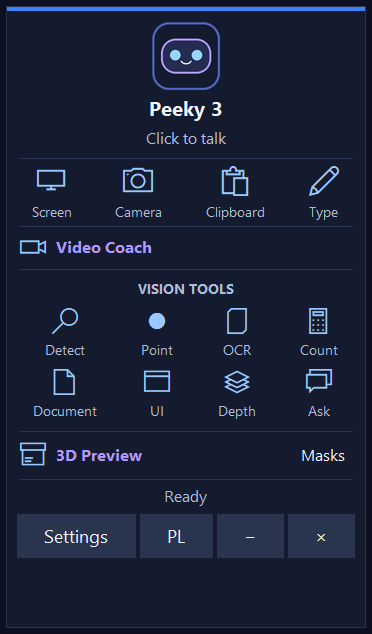

# Peeky 3



*Promotional illustration of Peeky 3 Portable.*

**Author:** Tomasz Wietrzykowski

Peeky 3 is a Windows desktop assistant for asking questions about a region of your screen or a snapshot from your camera. Select an image, then type or speak your question. Peeky sends the image to a local Ollama model and can read the answer aloud. The interface and voice controls support English and Polish.

See the [portable user guide](portable/README.md) for setup and controls.

## Screenshot



## Quick start

**Requirements:** Windows x64, Python 3.11 x64 with the `py` launcher, and Ollama. First-run setup downloads Python dependencies and speech models. The Ollama model is a separate download.

1. Install [Python](https://www.python.org/downloads/windows/) and [Ollama](https://ollama.com/download/windows) if needed. Start Ollama and download the default vision model:

   ```powershell
   ollama pull qwen3-vl:4b-instruct
   ```

   This is Peeky's default vision model and the one that ran reliably in local testing. Other image-capable models can be selected in **Settings**, with results varying by model.

2. Download `Peeky3-Portable.zip` from the release assets and extract it to a writable folder.
3. Run `Run-Peeky.cmd` from the extracted folder. The first launch prepares the Python environment and speech assets. Use the same file on later launches.
4. Choose **Screen** or **Camera**. Type a question, or click the Peeky logo to start recording and click it again to submit. Use **PL** and **EN** to switch languages. **Settings** lets you pick separate text and vision models. Choose an image-capable model for vision.

## Video Coach and vision tools

- **Video Coach.** Enter a goal and choose a camera or screen region. Use **Check** for one observation. With **Auto** enabled, each observation is analyzed and spoken before Peeky captures the next image. Auto pauses if speech playback fails. **Stop** ends the session.
- **Image analysis.** Ask follow-up questions about the selected image, extract text, point to an object, count instances, or highlight UI elements. Text, counts, and positions are estimates from the vision model.
- **Depth and 3D preview.** Depth Anything V2 Small estimates relative depth from one image. The preview renders a rotatable point cloud or mesh. The first use may download the model. Hidden surfaces remain empty.

## Data and privacy

Image and text prompts go to Ollama at `127.0.0.1:11434`. Speech recognition is local by default. If you switch off local recognition, the app can send recordings to Google's speech recognition service. The Microsoft online voice receives the text to be read aloud. You can turn it off in **Settings** to use a local voice.

Portable saves settings, logs, optional text history, and its downloaded voice and depth assets in the `Data` folder next to the launcher. The EXE installer uses `%LOCALAPPDATA%\Peeky3\Data`. Ollama manages its own models.

To remove a copy, close Peeky, run `Uninstall-Peeky.cmd` and type `YES`. The uninstaller removes the app and its shortcuts and keeps the `Data` folder.

## Build from source

Run this from the repository root:

```powershell
py -3.11 portable/build.py
```

The script writes `dist/Peeky3-Portable.zip`. Extract that ZIP and run `Run-Peeky.cmd` to test a release build.

The optional Windows installer is built with `installer\Build.ps1`. It requires Pillow and the .NET Framework C# compiler and writes `dist/Peeky3-Setup.exe`. The installer is unsigned.

## License

Peeky is released under the [MIT License](LICENSE). Dependencies and downloaded models have their own licenses.
